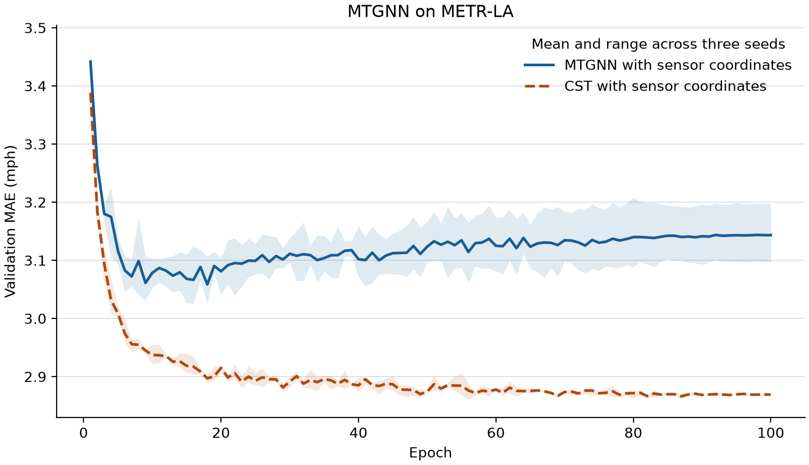
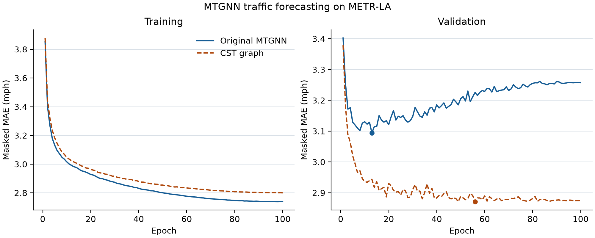

# METR-LA向け CST MTGNN

[English](README.md) | 日本語

METR-LAの207センサーで、先1時間の交通速度を予測するモデルです。
[MTGNN](https://arxiv.org/abs/2005.11650)のセンサー間結合の学習部分を、1つの
`CSTLinear`からスコアを作る方式と比較しました。時間方向の畳み込み、グラフ伝播、
予測ヘッドは元のアーキテクチャを使います。

## センサー座標を揃えた3シードの結果

**両モデルに同じセンサー座標を与えても、全3シードでCST版のテスト誤差が小さくなりました。**
3シードの平均では、**全12予測時点の誤差が5.5%減り、60分先では7.6%減りました。**

| 予測時点 | 座標付きMTGNN | CST版 | MAEの減少 | CST版の勝ち数 |
| --- | ---: | ---: | ---: | ---: |
| 15分先 | 2.919 | 2.803 | 4.0% | 3/3 |
| 30分先 | 3.347 | 3.180 | 5.0% | 3/3 |
| 60分先 | 3.861 | 3.568 | 7.6% | 3/3 |
| 全12時点 | 3.306 | 3.125 | 5.5% | 3/3 |

単位はmphで、テスト平均絶対誤差（MAE）が小さいほど精度が高いことを示します。
全12時点で集計した各シードのMAEは次のとおりです。

| シード | 座標付きMTGNN | CST版 | MAEの減少 |
| ---: | ---: | ---: | ---: |
| 17 | 3.332 | 3.130 | 6.1% |
| 29 | 3.281 | 3.121 | 4.9% |
| 43 | 3.305 | 3.123 | 5.5% |

元のMTGNNには学習可能なセンサーID埋め込みにスケール調整した座標を連結し、CST版では
同じ位置情報を固定Chartに使いました。各ペアでグラフ生成以外の初期重み、バッチ順、
データ分割を揃えています。RTX 4090でバッチサイズ64、各100エポックを一から学習し、
検証MAEでチェックポイントを選びました。CST版は512 Atom、Atomの初期学習率0.0048です。
グラフ生成のパラメータは20,000から3,072に減り、1回あたりの平均学習時間は
10.2分から11.2分になりました。



線は3シードの平均検証MAE、帯は各エポックでの最小値から最大値までの範囲です。

[シード別の結果（CSV）](results/coordinate-controlled/test-by-seed.csv) · [集計結果（JSON）](results/coordinate-controlled/summary.json)

## 公開済みの重みで予測

Python 3.11以降を使います。CLIは[Hugging Face](https://huggingface.co/takumiecd/cst-mtgnn-metr-la)
からモデル構成とSafetensorsを取得し、`torchcst.hub.from_pretrained()`で指定デバイスに
配置します。
ダウンロードできる2つのチェックポイントは、後述する初回のシード17の比較で得たものです。

```bash
git clone https://github.com/takumiecd/cst-mtgnn-metr-la.git
cd cst-mtgnn-metr-la
python -m pip install -r requirements.txt
mkdir -p data
curl -fL 'https://zenodo.org/records/5146275/files/METR-LA.csv?download=1' -o data/METR-LA.csv
python infer.py data/METR-LA.csv --test-index 0 --sensor 773869 --variant cst
```

テスト分割の先頭の入力窓に対して、5分刻みで12点の予測値と実測値が返ります。同じ入力で
元モデルを動かすには `--variant baseline`、CUDA対応PyTorchでGPUを使うには
`--device cuda` を指定します。独自のCSVを使う場合は、先頭を時刻列として、5分刻みで
METR-LAの207センサーIDを全列に入れ、`--test-index` を省きます。センサー列の並び順は
自由で、最後の12行から先1時間を予測します。

### 同じモデルで繰り返し予測するときにグラフを再利用

評価モードでは学習済みグラフが固定されます。同じ重みと207センサーで繰り返し予測する場合、
隣接行列を一度計算し、MTGNNの固定隣接行列を使う経路に渡せます。公開チェックポイントを
使ったテスト入力8窓では、予測の最大差は0 mphでした。

| モデル（バッチ1） | 毎回グラフを作成 | グラフを再利用 |
| --- | ---: | ---: |
| MTGNN | 4.46 ms | 4.24 ms |
| CST MTGNN | 5.59 ms | 4.19 ms |

Apple M4 ProのCPUでPyTorchを2スレッド使い、40回の推論の中央値を計測しました。
事前計算したFP32の隣接行列は167.4 KiBです。[計測コード](benchmark_inference_graph.py)には
8窓をまとめた推論も記録する設定があります。

## 公開チェックポイントの初回比較

欠損を除外したテストMAE。単位はmphで、小さいほど精度が高い。

| モデル | 15分先 | 30分先 | 60分先 | 全12ホライズン | グラフ生成のパラメータ数 |
| --- | ---: | ---: | ---: | ---: | ---: |
| MTGNN | 2.938 | 3.401 | 3.960 | 3.355 | 19,840 |
| CST MTGNN | 2.809 | 3.190 | 3.573 | 3.132 | 3,072 |

CST版はグラフ生成のパラメータを84.5%削減し、平均テストMAEを6.7%改善した。
自己ループを加える前の正の有向エッジは元モデルが4,140本、CST版が884本だった。
RTX 4090で10更新をウォームアップした後の60更新の中央値は、元モデル16.08 ms、
CST版17.15 msだった。学習比較は1 seedで、CST側のChartには地理座標を使った。



[結果JSON](results/summary.json)

## 学習と評価

ベースラインは`upstream/` の
[MITライセンスの公式MTGNNソース](https://github.com/nnzhan/MTGNN/tree/f811746fa7022ebf336f9ecd2434af5f365ecbf6)
を使います。CST版は[DCRNNのセンサー座標](https://github.com/liyaguang/DCRNN/blob/602afd9d767d3aa1c9b3eac51710d6aeee12c227/data/sensor_graph/graph_sensor_locations.csv)
から固定Chartを作ります。512 Atomの `CSTLinear` の因子から207×207スコア行列を作ります。
両版とも同じ有向スコア変換、top-20のマスク、自己ループと正規化を使います。学習中は
順位付けにノイズを加え、評価時は決定的なtop-kにします。

RTX 4090を1枚使い、バッチ64、100エポックで全12ホライズンをランダム初期化から
学習しました。共通パラメータには初期学習率0.001のAdamWとコサイン減衰を使い、CSTの
Atom群の初期学習率は0.0048です。ゼロ速度は欠損として学習・評価から除外します。
時刻列を70%と80%の地点で分け、予測対象が1つの分割内に収まる窓を使用します。
正規化の統計値は学習入力から求め、全12ホライズン平均の検証MAEが最小のチェックポイントを
テスト評価します。

```bash
curl -fL 'https://raw.githubusercontent.com/liyaguang/DCRNN/602afd9d767d3aa1c9b3eac51710d6aeee12c227/data/sensor_graph/graph_sensor_locations.csv' -o data/locations.csv
for seed in 17 29 43; do
  for variant in baseline_coords cst; do
    OMP_NUM_THREADS=2 MKL_NUM_THREADS=2 python train.py --variant "$variant" \
      --data data/METR-LA.csv --locations data/locations.csv --epochs 100 \
      --batch-size 64 --atoms 512 --seed "$seed" \
      --output "output/coordinate-controlled/seed-$seed-$variant"
  done
done
```

初回の比較を再現し、公開済みの2種類の重みをエクスポートするには、以下を実行します。

```bash
for variant in baseline cst; do
  OMP_NUM_THREADS=2 MKL_NUM_THREADS=2 python train.py --variant "$variant" \
    --data data/METR-LA.csv --locations data/locations.csv --epochs 100 \
    --batch-size 64 --atoms 512 --seed 17 --output "output/paired/$variant"
done
python export.py --run output/paired --output output/weights
```

## PEMS-BAYでの別道路網の検証

ベイエリア325センサーの[交通速度データ](https://zenodo.org/records/5146275)と
[DCRNNの座標](https://github.com/liyaguang/DCRNN/blob/602afd9d767d3aa1c9b3eac51710d6aeee12c227/data/sensor_graph/graph_sensor_locations_bay.csv)を
使い、両モデルを一から学習しました。RTX 4090 1枚で時系列順に70/10/20で分割し、
10エポック、バッチ64、2シードで比較しました。各ペアのグラフ以外の初期重みと
データ順を揃え、検証MAEで選んだチェックポイントをテスト10,412窓で評価しました。
時刻は米太平洋時間を保持し、夏時間が始まる日もUTCで5分間隔を確認しています。

| テストMAE（mph）、2シード平均 | 座標付きMTGNN | CST版 | 誤差減少 |
| --- | ---: | ---: | ---: |
| 全12予測時点 | 1.741 | 1.616 | 7.1% |
| 60分先 | 2.207 | 1.986 | 10.0% |
| 実測45 mph未満 | 7.553 | 6.751 | 10.6% |

全12時点のMAEは両シードでCST版が下回りました。直近速度を維持する予測は2.170 mph、
曜日と時刻別の中央値を直近値で補正する予測は1.894 mphでした。補正の強さは検証分割で
選びました。CST版のグラフ部分は29,440から3,072パラメータに減り、短時間計測の
更新時間中央値はMTGNNの37.6 msに対して38.8 msでした。ピーク割当は両方とも約2.30 GiBです。

[検証曲線](results/pems-bay/validation-curves.png) ·
[シードごとの結果](results/pems-bay/test-by-seed.csv) ·
[指標と比較手法の集計](results/pems-bay/summary.json)

初回シードのSafetensorsはCPUに読み込み、予測CLIで動作を確認しました。
エクスポートには `baseline_coords/` と `cst/` のペアを指定します。
座標ファイルにはDCRNN配布のCSVに `sensor_id,latitude,longitude` のヘッダーを付けます。

```bash
for seed in 17 29; do
  for variant in baseline_coords cst; do
    OMP_NUM_THREADS=2 MKL_NUM_THREADS=2 python train.py --dataset pems-bay \
      --variant "$variant" --data data/PEMS-BAY.csv --locations data/locations-bay.csv \
      --epochs 10 --batch-size 64 --atoms 512 --seed "$seed" \
      --output "output/pems-bay/s$seed/$variant"
  done
done
python export.py --run output/pems-bay/s17 --baseline-variant baseline_coords \
  --output output/pems-bay/weights-s17
```

### 100エポックの本比較

RTX 4090 1枚で両モデルを一から100エポックずつ、シード17・29・43で学習しました。
同じデータ分割とバッチ64を使い、各ペアでグラフ以外の初期重みとデータ順を揃えました。
各ランで検証MAEが最小のチェックポイントを使い、テストMAEを測りました。

| テストMAE（mph）、3シード平均 | 座標付きMTGNN | CST版 | 誤差減少 |
| --- | ---: | ---: | ---: |
| 全12予測時点 | 1.745 | 1.586 | 9.1% |
| 15分先 | 1.413 | 1.333 | 5.6% |
| 30分先 | 1.794 | 1.654 | 7.8% |
| 60分先 | 2.206 | 1.928 | 12.6% |

全時点のテストMAEはCST版が3シードすべてで下回りました。検証最良時点は
座標付きMTGNNが20・11・10エポック、CST版が74・89・81エポックでした。
1ランの平均時間は36.43分と38.03分、ピーク割当はそれぞれ2.296 GiBと2.303 GiBです。
全6件のチェックポイントをSHA-256で照合しました。

[検証曲線](results/pems-bay-100/validation-curves.png) ·
[シード別結果](results/pems-bay-100/test-by-seed.csv) ·
[集計とチェックポイントのハッシュ](results/pems-bay-100/summary.json)

### PEMS-BAYの全325センサーをHTTPで予測

エクスポートしたPEMS-BAYの重みでローカルHTTPサービスを起動します。

```bash
python forecast_service.py --config output/pems-bay/weights-s17/config.json \
  --weights output/pems-bay/weights-s17/cst.safetensors
curl -fsS http://127.0.0.1:8080/health
curl -fsS -H 'Content-Type: application/json' --data-binary @request.json \
  http://127.0.0.1:8080/forecast
```

リクエストには `timestamps`（UTCオフセット付きISO 8601で5分間隔の12点）、
`sensor_ids`（列順のセンサーID）、`speeds_mph`（IDごとに速度を並べた12行）を指定します。
`null`、ゼロ、省略したセンサー列は欠測として扱います。既定では入力窓内の直近有効値を
センサーごとに引き継ぎ、先頭の欠測や全点が欠測の列は学習時の平均速度で補います。
応答にはチェックポイント順の全325センサー、次の12時点と予測速度、欠測値数と全点欠測の
センサー数が含まれます。モデルの読み込みと隣接行列の計算は起動時の一度です。

Apple M4 Pro CPU、PyTorch 2スレッドでローカルHTTPリクエストを40回計測し、中央値は
9.24 ms、95パーセンタイルは9.85 msでした。同じテスト入力で、従来の単一センサーCLIの
予測値と一致しました。[動作検証](results/pems-bay/service.json)

各入力窓で無作為に選んだ33センサーを欠測させ、モデルと補完方法の間で同じマスクを使いました。
補完方法は検証分割で選びました。表はテスト10,412窓で欠測対象になったセンサーのMAEを、
CST版の2シードで平均した値です。

| 欠測の範囲 | ゼロのまま入力 | 有効値から補完 |
| --- | ---: | ---: |
| 直近15分 | 36.79 mph | 1.90 mph |
| 入力の60分全体 | 38.90 mph | 4.80 mph |

人為的な欠測を入れる前の同じ対象センサーでは、MAEは1.62 mphでした。
[欠測試験の結果](results/pems-bay/outages.json) · [計測コード](benchmark_sensor_outages.py)

新規コードと配布重みは[Apache-2.0](LICENSE)、同梱したMTGNNソースは
[MITライセンス](upstream/LICENSE)です。
