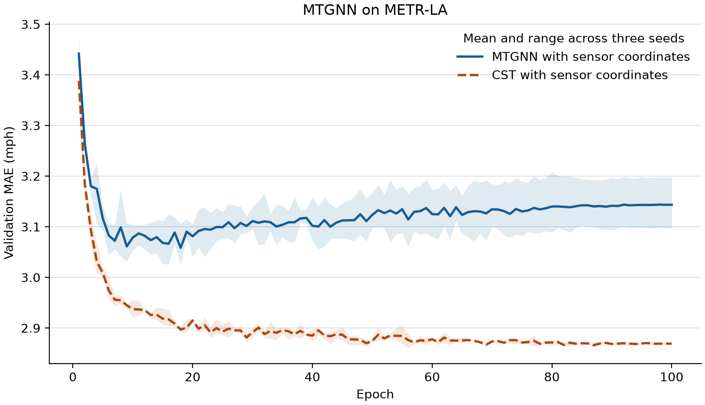
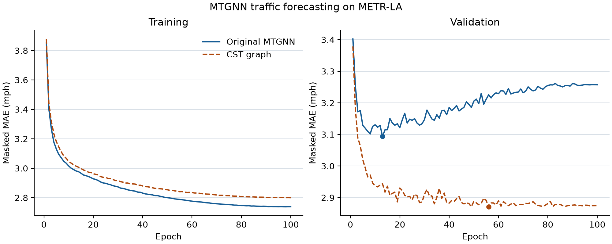

# CST MTGNN for METR-LA

English | [日本語](README.ja.md)

Predict the next hour of traffic speed at 207 METR-LA sensors. This project
compares the [MTGNN](https://arxiv.org/abs/2005.11650) learned sensor graph
with a graph whose scores come from one `CSTLinear`. The time-series
convolutions, graph propagation and forecast head use the original architecture.

## Three-seed results with shared sensor coordinates

**CST had lower test MAE in all three seeds when both models received the same
sensor coordinates.** Averaged across seeds, MAE fell by **5.5% across all 12
forecast steps** and by **7.6% at 60 minutes**.

| Forecast horizon | MTGNN + coordinates | CST + coordinates | MAE reduction | Seeds favoring CST |
| --- | ---: | ---: | ---: | ---: |
| 15 min | 2.919 | 2.803 | 4.0% | 3/3 |
| 30 min | 3.347 | 3.180 | 5.0% | 3/3 |
| 60 min | 3.861 | 3.568 | 7.6% | 3/3 |
| All 12 steps | 3.306 | 3.125 | 5.5% | 3/3 |

The test MAE is in miles per hour (lower is better). Here is the all-step MAE for
each pair.

| Seed | MTGNN + coordinates | CST + coordinates | MAE reduction |
| ---: | ---: | ---: | ---: |
| 17 | 3.332 | 3.130 | 6.1% |
| 29 | 3.281 | 3.121 | 4.9% |
| 43 | 3.305 | 3.123 | 5.5% |

MTGNN concatenates the scaled coordinates to its learned sensor ID embeddings.
CST uses the same locations in its fixed Chart. Each pair shares the initial
weights outside the graph generator, batch order, and data split. Both models
trained from scratch for 100 epochs on an RTX 4090, with batch size 64 and
checkpoint selection by validation MAE. The CST graph uses 512 Atoms, with an
initial Atom learning rate of 0.0048. The graph parameter count fell from
20,000 to 3,072, and mean training time rose from 10.2 to 11.2 minutes per run.



The lines show the mean validation MAE across the three seeds. The shaded areas
span the minimum and maximum at each epoch.

[Per-seed results (CSV)](results/coordinate-controlled/test-by-seed.csv) · [Summary (JSON)](results/coordinate-controlled/summary.json)

## Forecast from the published weights

Use Python 3.11 or newer. The CLI downloads the model configuration and
Safetensors weights from [Hugging Face](https://huggingface.co/takumiecd/cst-mtgnn-metr-la)
and uses `torchcst.hub.from_pretrained()` to place the model on the selected device.
The two downloadable checkpoints come from the initial seed-17 comparison below.

```bash
git clone https://github.com/takumiecd/cst-mtgnn-metr-la.git
cd cst-mtgnn-metr-la
python -m pip install -r requirements.txt
mkdir -p data
curl -fL 'https://zenodo.org/records/5146275/files/METR-LA.csv?download=1' -o data/METR-LA.csv
python infer.py data/METR-LA.csv --test-index 0 --sensor 773869 --variant cst
```

This returns 12 five-minute forecasts with observed values for the first held-out
forecast window. Set `--variant baseline` to run the original model on the same
input. Set `--device cuda` with a CUDA-enabled PyTorch installation. To use your
own CSV, provide a timestamp column followed by all 207 METR-LA sensor-ID
columns at five-minute intervals and omit `--test-index`. The CLI forecasts
from the last 12 rows and accepts any sensor-column order.

## Initial comparison for the published checkpoints

Masked test MAE in miles per hour. Lower is better.

| Model | 15 min | 30 min | 60 min | All 12 horizons | Graph parameters |
| --- | ---: | ---: | ---: | ---: | ---: |
| MTGNN | 2.938 | 3.401 | 3.960 | 3.355 | 19,840 |
| CST MTGNN | 2.809 | 3.190 | 3.573 | 3.132 | 3,072 |

The CST graph reduced graph-generator parameters by 84.5%. Its average
test MAE was 6.7% lower. The graph contains 884 positive directed edges
before self-loops, compared with 4,140 from the baseline. In a 60-update
RTX 4090 pilot after ten warmup updates, median update time was
16.08 ms for the baseline and 17.15 ms for CST. The full runs use one
training seed and a geographic prior in the CST graph.



[Machine-readable results](results/summary.json)

## Training and evaluation

The baseline follows the MIT-licensed [MTGNN source](https://github.com/nnzhan/MTGNN/tree/f811746fa7022ebf336f9ecd2434af5f365ecbf6)
in `upstream/`. The CST variant uses a fixed Chart built from the
[DCRNN sensor coordinates](https://github.com/liyaguang/DCRNN/blob/602afd9d767d3aa1c9b3eac51710d6aeee12c227/data/sensor_graph/graph_sensor_locations.csv).
The rank-one factors of a 512-Atom `CSTLinear` produce a 207×207 score matrix.
Both variants use the same directional score transform, top-20 masking,
self-loop handling and normalization. Ranking jitter is used during training
and evaluation uses deterministic top-k.

Each run trains all 12 horizons from random initialization, with batch size 64
and 100 epochs on one RTX 4090. The shared parameters use AdamW
with initial LR 0.001 and cosine decay. The CST Atom group starts at 0.0048.
Training and evaluation omit zero-speed missing targets. We split chronologically
at 70% and 80% of timestamps and retain target windows entirely inside one split.
Normalization is fitted on training inputs. Each model is tested using the
checkpoint with the lowest validation MAE averaged over all 12 horizons.

```bash
curl -fL 'https://raw.githubusercontent.com/liyaguang/DCRNN/602afd9d767d3aa1c9b3eac51710d6aeee12c227/data/sensor_graph/graph_sensor_locations.csv' -o data/locations.csv
for seed in 17 29 43; do
  for variant in baseline_coords cst; do
    OMP_NUM_THREADS=2 MKL_NUM_THREADS=2 python train.py --variant "$variant" \
      --data data/METR-LA.csv --locations data/locations.csv --epochs 100 \
      --batch-size 64 --atoms 512 --seed "$seed" \
      --output "output/coordinate-controlled/seed-$seed-$variant"
  done
done
```

To reproduce the initial comparison and export the two published variants, run
the following commands.

```bash
for variant in baseline cst; do
  OMP_NUM_THREADS=2 MKL_NUM_THREADS=2 python train.py --variant "$variant" \
    --data data/METR-LA.csv --locations data/locations.csv --epochs 100 \
    --batch-size 64 --atoms 512 --seed 17 --output "output/paired/$variant"
done
python export.py --run output/paired --output output/weights
```

New code and released weights use [Apache-2.0](LICENSE). The vendored
MTGNN source uses its [MIT license](upstream/LICENSE).
